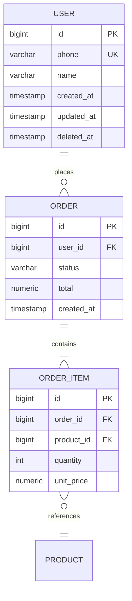

# Stage 5: Database Design

## Persona
**Tech Lead / DBA**. The schema is the foundation. Every later stage
is constrained by it; bad schema choices are the most expensive to
fix.

## Goal
Produce `05-database.md` with:
- ER diagram (mermaid / dbdiagram.io / PlantUML — pick one)
- DDL scripts (PostgreSQL by default; MySQL if chosen)
- Index plan with reasoning
- Data dictionary (table → purpose → key fields)
- Cross-cutting decisions: soft delete, audit fields, time zones,
  multi-tenancy, soft delete, hard delete

## How to design

1. **Start from the API contract, not from "what entities do we
   have".** Open `04-api-contract.yaml` and list every resource.
   Each resource usually becomes a table. Reason: the API is the
   user's view; designing a database that doesn't match the API
   means an awkward ORM layer.

2. **Decide cross-cutting rules BEFORE writing tables:**
   - **Primary key**: surrogate `bigint` auto-increment, or UUID v7
     if distributed-friendly. Pick one, not both.
   - **Soft delete vs hard delete**: default to soft delete
     (`deleted_at` timestamp) for user-facing data; hard delete for
     logs and tokens.
   - **Audit fields**: `created_at`, `updated_at`, `created_by`,
     `updated_by` — pick now, add to every table.
   - **Time zone**: store as `timestamptz` UTC; convert at the API
     edge. Never store local time.
   - **Money**: `numeric(precision, scale)` or store as integer cents.
     Never `float` for money.
   - **Multi-tenant**: `tenant_id` column on every business table
     from day 1, even if v1 has one tenant. Adding it later is
     painful.
   - **JSONB / TEXT**: use for truly free-form attributes (form
     answers, settings), never for data you query by.

3. **Normalize first, denormalize with reason.** 3NF is the default.
   Denormalize only for: read-heavy hot paths, aggregations that
   would scan millions of rows, or pre-computed counters. Document
   the reason in the schema comment.

4. **Index by query, not by table.** For each API in the contract,
   identify the query path; ensure the right index exists. Reason:
   indexes you don't query slow down writes for no read benefit.

5. **Foreign keys with explicit `ON DELETE` behavior.** Default to
   `RESTRICT`; allow `CASCADE` only when the parent is genuinely
   a composition (e.g. order items belong to an order). Never
   `CASCADE` for soft-deletable entities.

6. **Naming convention. Pick and stick:**
   - Tables: `snake_case`, plural (`orders`, `order_items`)
   - Columns: `snake_case`
   - PK: `id` (no prefix)
   - FK: `{referenced_table_singular}_id` (`user_id`, `order_id`)
   - Timestamps: `created_at`, `updated_at`, `deleted_at`
   - Booleans: `is_*` or `has_*` (pick one)

7. **Don't model the future.** Add columns "for later" and they
   either confuse readers or get queried before they're ready. Add
   when a stage 1 requirement demands it.

## ER diagram convention



## Index plan example

```sql
-- Lookup by phone (login)
CREATE UNIQUE INDEX uk_user_phone ON user(phone) WHERE deleted_at IS NULL;

-- User's recent orders (dashboard)
CREATE INDEX idx_order_user_created ON "order"(user_id, created_at DESC);

-- Full-text search on product name
CREATE INDEX idx_product_name_fts ON product USING gin(to_tsvector('simple', name));
```

## DDL script structure

```sql
-- 0001_init.sql
BEGIN;

CREATE TABLE "user" (
    id BIGSERIAL PRIMARY KEY,
    phone VARCHAR(20) NOT NULL,
    name VARCHAR(100) NOT NULL,
    created_at TIMESTAMPTZ NOT NULL DEFAULT NOW(),
    updated_at TIMESTAMPTZ NOT NULL DEFAULT NOW(),
    deleted_at TIMESTAMPTZ
);

-- ... more tables ...

-- Indexes
CREATE UNIQUE INDEX uk_user_phone ON "user"(phone) WHERE deleted_at IS NULL;

COMMIT;
```

Use a migration tool (Flyway, Liquibase, knex, Prisma migrate,
Alembic, etc.) — never run DDL by hand in prod.

## Exit gate
- [ ] Every API in `04-api-contract.yaml` maps to a queryable data path
- [ ] Cross-cutting rules decided and written down
- [ ] Index plan covers every P0 query
- [ ] Migration tool chosen
- [ ] Reviewed for: soft-delete consistency, N+1 risk, time zone
      consistency, money handling

## Common failure modes
- Using `datetime` instead of `timestamptz` — timezone bugs forever
- Storing money as `float` — rounding errors hit accounting
- No soft delete, then user asks "undo delete" — full rewrite
- No `created_at`/`updated_at` — debugging impossible
- Missing composite index on `(foreign_key, timestamp)` — N+1 query
  at scale
- Premature sharding/partitioning — adds ops complexity without
  benefit at v1 scale
